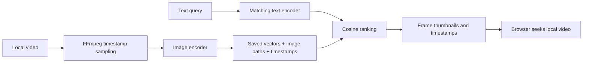

# Video Moment Search

Search local video frames with a text query and jump to the matching timestamps in a browser player. A video is sampled once, image vectors are saved alongside timestamps, and later queries compare their vectors against that index. Frame images and the source video remain local.

The optional semantic encoder is [EmbeddingGemma 2](https://ai.google.dev/gemma/docs/embeddinggemma/model_card_2), using its actual vision path and text backbone. A separate, clearly labelled color fixture runs without downloading a model: it measures RGB pixels and recognizes only the words red, green and blue. Fixture results exercise file, vector, timestamp and player plumbing; they do not establish semantic retrieval quality.

## Run the local demo

Requires Python 3.10+ and Pillow. Install [FFmpeg](https://ffmpeg.org/download.html) with `ffmpeg` and `ffprobe` on PATH for real video sampling and the generated three-second demo video.

```powershell
python -m pip install -r requirements.txt
python -B app.py --port 8843
```

Open [http://127.0.0.1:8843](http://127.0.0.1:8843), search `blue frame`, and choose **Jump to moment**. The demonstration creates three colored PNG frames and, when FFmpeg is available, a real MP4 with corresponding moments at 0, 1 and 2 seconds. Without FFmpeg, image search still works and the page displays timestamp results without a video player.

The server binds only to loopback. Stop it with Ctrl+C. Generated files live under ignored `.local/`.

```powershell
python -B video_search.py demo --out .local/demo
python -B video_search.py search .local/demo/index.json "blue frame"
python -B -m unittest discover -s tests -v
```

## Index a real video with the semantic model

Install package versions supporting the model's multimodal architecture; the [official multimodal guide](https://ai.google.dev/gemma/docs/embeddinggemma/multimodal-embeddinggemma-with-sentence-transformers) documents the current environment. The model path loads weights only when selected and may download them on its first run. After weights are cached, inference is local. No remote embedding API is used.

```powershell
python -m pip install -r requirements-model.txt
python -B video_search.py index C:\Videos\example.mp4 --out .local/my-video --interval 1 --max-frames 60
python -B video_search.py search .local/my-video/index.json "a person walking beside a lake"
python -B app.py --index .local/my-video/index.json --port 8843
```

The encoder loads `google/embeddinggemma-2` on CPU in float32, disables its unused audio encoder and keeps vision enabled. Each extracted frame gets its own image embedding. Plain text queries use the same model, and normalized cosine similarity ranks frames. Text-only GGUF checkpoints cannot replace this vision path. This implementation retrieves visual evidence; it does not transcribe sound or generate a chat answer.

`--fixture` on the `index` command intentionally replaces the model with the RGB fixture for testing a colored video. It is unsuitable for general video search. The saved backend identifier prevents querying a semantic index with fixture vectors.

## Architecture



## Code map

| File | Responsibility |
|---|---|
| `video_search.py` | FFmpeg sampling, validated vector/index storage, real multimodal model adapter, explicit pixel fixture, search, synthetic media generation and CLI. |
| `app.py` | Loopback HTTP page, search JSON endpoint, bounded frame-path serving and video byte ranges for seeking. |
| `tests/test_search.py` | Actual image-pixel and timestamp ranking; index validation; mocked native model input contract; real FFmpeg video extraction when installed; local HTTP and seek-range checks. |
| `requirements.txt` | Pillow dependency for image handling and the offline fixture. |
| `requirements-model.txt` | Optional native semantic model environment. |
| `.gitignore` | Excludes local videos, generated frame/index data, environments and caches. |

## Verification and limits

The tests include an actual generated MP4 → FFmpeg frame extraction → image-pixel vectors → timestamp retrieval path when FFmpeg is installed. HTTP tests check the page, search, PNG data and range responses. Model-adapter tests replace the model object; actual pretrained EmbeddingGemma 2 inference and semantic quality have not been verified. No hardware latency or throughput result is claimed.

Sampling records the requested seek position; codec frame boundaries can differ slightly. It does not recover every exact presentation timestamp. At most 300 frames are accepted, saved vectors must be finite and dimensionally consistent, and image paths must remain within the index directory. This is a small local index, not a large video search service. The browser codec support depends on the supplied video's format; the generated demo uses H.264 MP4.

Primary implementation references: [official image/text and video examples](https://ai.google.dev/gemma/docs/embeddinggemma/multimodal-embeddinggemma-with-sentence-transformers), [Google Gemma cookbook](https://github.com/google-gemma/cookbook), and [Sentence Transformers](https://github.com/huggingface/sentence-transformers). No upstream implementation is copied into this repository.
